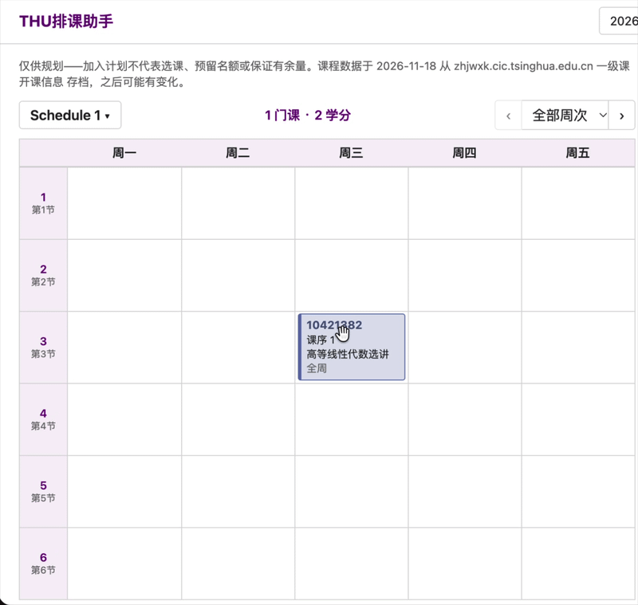

# THU Scheduler

[中文](README.md) | **English**

**[thu-scheduler.hughzhao.com](https://thu-scheduler.hughzhao.com)**

Plan your timetable before enrollment: search the course offerings, compare sections, and see your week at a glance. Available in Chinese and English.

## What you can do

- **Find courses** by course number, name, or instructor. In English mode you can also search by English course name.
- **Build your week.** Add a section and it appears on the weekly grid by class period (大节). Courses that meet only in some weeks (前八周, 后八周, odd or even weeks) show up only in those weeks; step through the term week by week to see each one.
- **Drag to switch sections.** Preview a section before adding it, or **drag** a class on the grid straight onto another time of the same course to switch sections.

  

- **Spot conflicts.** Two classes conflict only when they share a day, a period, and a teaching week, so a first-half and a second-half course in the same slot don't conflict.
- **Add personal events** such as club meetings or a part-time job.
- **Compare plans.** Keep several schedules per term and switch between them.
- **Review the details:** total credits, archived seat counts, course descriptions, grading, textbooks, and lab information.
- **Share a schedule** with a link. Whoever opens it sees your classes and can save a copy.
- **Export to your calendar.** Download an `.ics` file with every class on its real date and time, ready for Google Calendar, Apple Calendar, or Outlook. No classes are placed on holidays.

## Good to know

- **Your schedules stay in your browser.** There's no account, and nothing is uploaded. Clearing your browser data removes them; use a share link to move a schedule to another device.
- **Calendar export** currently supports only the 2026–2027 spring term. Make-up class days (调休) will be added once the university announces them.

## License

See [LICENSE](LICENSE).
