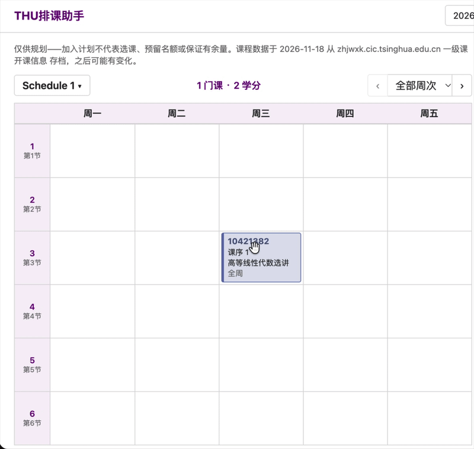

# THU排课助手

**中文** | [English](README.en.md)

**[thu-scheduler.hughzhao.com](https://thu-scheduler.hughzhao.com)**

在选课前规划课表：搜索开课信息，比较不同课序，一眼看清每周安排。支持中文和英文界面。

## 你可以做什么

- **查找课程**：按课程号、课程名或教师搜索。英文界面下也可以按英文课程名搜索。
- **排出一周课表**：添加课序后，课程会按大节显示在周课表上。只在部分周上课的课程（前八周、后八周、单周、双周等）只会出现在对应的教学周，可以逐周切换查看。
- **拖拽排课**：添加前可以先预览课序，也可以把课表上的课程**直接拖拽**到同课程号的其他时间完成调课。

  

- **发现时间冲突**：只有星期、节次和教学周都重叠时才算冲突，所以同一时段的前八周课程和后八周课程不会冲突。
- **添加个人事项**：例如社团活动或兼职。
- **比较多个方案**：每个学期可以保存多份课表，随时切换。
- **查看课程详情**：总学分、存档时的余量、课程简介、考核方式、教材和实验信息。
- **分享课表**：生成一个链接，朋友打开后可以看到你的课程并保存一份副本。
- **导出日历**：下载 `.ics` 文件，把每节课放到实际的日期和时间上，可导入 Google 日历、Apple 日历或 Outlook。放假日不会安排课程。

## 注意事项

- **课表只保存在你的浏览器中**：无需注册，也不会上传任何数据。清除浏览器数据会删除课表；可以用分享链接把课表转到别的设备。
- **日历导出**：目前仅支持2026–2027学年春季学期。调休补课安排要等学校公布后才会加入。

## 许可

见 [LICENSE](LICENSE)。
